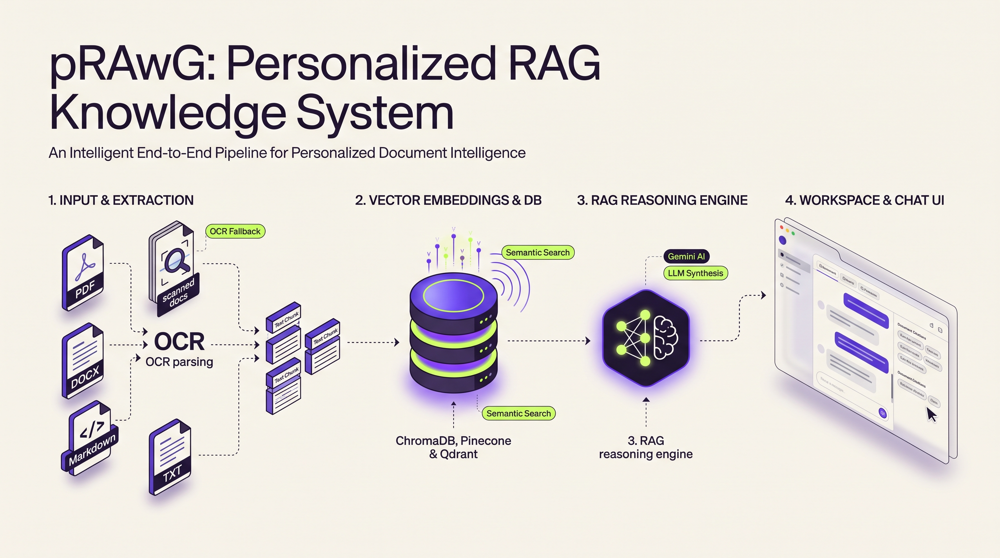

# pRAwG

A container-first personalized RAG workspace for searching documents and asking grounded questions with Google Gemini.



pRAwG turns private documents into a searchable knowledge base. It extracts and
chunks files, creates local embeddings with Ollama, stores vectors in a selectable
database, preserves originals in MinIO, and asks Gemini to answer from retrieved
context. The Next.js workspace provides chat, ingestion, collection management,
source citations, downloads, and live storage totals.

## Quick start

With Docker Compose v2 and a Gemini API key available:

```bash
git clone https://github.com/m-irtezahussain/pRAwG.git
cd pRAwG
cp .env.example .env
# Add GOOGLE_API_KEY to .env, then continue:
docker compose up -d --build
docker compose exec ollama ollama pull nomic-embed-text-v2-moe:latest
```

Open <http://127.0.0.1:3000/app>. See [Step-by-step setup](#step-by-step-setup)
for prerequisites, verification, first-use instructions, and alternatives.

## Why use pRAwG?

- Keep original documents, vector data, and embeddings in infrastructure you control.
- Ingest PDF, DOCX, XLSX, CSV, TXT, Markdown, and scanned PDF content through one UI.
- Switch between self-hosted and managed vector databases without changing the chat flow.
- Receive document-grounded answers that show only the documents Gemini directly cited.
- Use it for a personal or team-local knowledge workspace, evaluation environment, or RAG starter.

pRAwG is not yet intended as a public multi-tenant SaaS: authentication, tenant
isolation, malware scanning, rate limiting, and production TLS termination are not
included.

## Features

### Document ingestion

- Upload PDF, DOCX, XLSX, CSV, TXT, and Markdown files up to 25 MB by default.
- Extract embedded PDF text and automatically use Tesseract OCR when a page has little text.
- Parse spreadsheet rows and cells with archive, expansion, row, and cell safety limits.
- Rename a file during upload while preserving its original extension.
- Attach up to 20 validated metadata fields to the original object and every vector chunk.
- Split text into configurable overlapping chunks before embedding and indexing.
- Store originals under a SHA-256 document identifier in a private MinIO bucket.

### Grounded chat

- Retrieve semantically relevant chunks from the active vector collection.
- Send document context and up to 20 recent conversation messages to Gemini.
- Require structured citations from Gemini and show only directly supporting documents.
- Deduplicate multiple cited chunks from the same document.
- Refuse to invent an answer when the indexed context does not contain the information.
- Correlate failures with privacy-safe request IDs and detailed server logs.

### Knowledge and storage management

- View the active vector provider and collection.
- Browse collections or namespaces and inspect stored chunks and metadata.
- Search a collection by semantic similarity or exact text/metadata matching.
- Delete individual vector chunks.
- Browse and download durable original documents from the Cloud view.
- Track live stored bytes, document count, collection count, and indexed chunk totals.

### Supported vector stores

| Provider | Deployment modes |
|---|---|
| Chroma | Self-hosted and Chroma Cloud |
| Pinecone | Pinecone Cloud index and optional namespace |
| Qdrant | Self-hosted and Qdrant Cloud |

Connections submitted through the UI are tested before activation. Credentials remain
in API process memory, are not returned to the browser, and are lost when the API restarts.

## Prerequisites

The recommended setup requires:

- Git
- Docker Desktop or Docker Engine with Docker Compose v2
- A Google Gemini API key from [Google AI Studio](https://aistudio.google.com/app/apikey)
- Internet access for the first image build, dependency download, model pull, and Gemini requests
- Several gigabytes of free disk space for images, the embedding model, and application data

## Step-by-step setup

### 1. Clone the repository

```bash
git clone https://github.com/m-irtezahussain/pRAwG.git
cd pRAwG
```

### 2. Create the environment file

```bash
cp .env.example .env
```

Open `.env` and set your Gemini key:

```dotenv
CHAT_PROVIDER=gemini
GOOGLE_API_KEY=<your Google AI Studio API key>
GEMINI_MODEL=gemini-3.8-flash
```

Do not commit `.env`. Replace the development MinIO passwords before using the stack
outside a trusted local machine.

### 3. Build and start the services

```bash
docker compose up -d --build
```

The first build compiles the pinned MinIO Community source and downloads the Python,
Node.js, Chroma, and Ollama dependencies, so it can take several minutes.

### 4. Install the required embedding model

Embeddings use Ollama even when Gemini is the chat provider:

```bash
docker compose exec ollama ollama pull nomic-embed-text-v2-moe:latest
```

Confirm that it is installed:

```bash
docker compose exec ollama ollama list
```

### 5. Verify the stack

```bash
docker compose ps
curl http://127.0.0.1:8080/health/live
curl http://127.0.0.1:8080/health/ready
```

Expected health responses:

```text
{"status":"ok"}
{"status":"ready"}
```

If readiness fails immediately after the model pull, restart the API and try again:

```bash
docker compose restart api
```

### 6. Open the application

- Workspace: <http://127.0.0.1:3000/app>
- Landing page: <http://127.0.0.1:3000>
- Interactive API documentation: <http://127.0.0.1:8080/docs>
- MinIO console: <http://127.0.0.1:9001>

All published ports bind to loopback by default.

### 7. Create your first result

1. Open the workspace and select **Manage Knowledge Base**.
2. Confirm the default self-hosted Chroma connection is active.
3. Select **Add data** and choose a supported document.
4. Optionally rename it or add metadata, then submit the upload.
5. Wait for the indexed-chunk confirmation.
6. Open **Chat** and ask a question whose answer appears in the document.
7. Review the cited document badge under the answer.
8. Open **Your cloud** to inspect storage totals or download the original file.

## Common usage

### Upload a document through the API

```bash
curl \
  -F 'file=@./document.pdf' \
  -F 'filename=research-summary.pdf' \
  -F 'metadata={"author":"Ada","project":"Knowledge base"}' \
  http://127.0.0.1:8080/api/v1/documents
```

### Run semantic search

```bash
curl -X POST http://127.0.0.1:8080/api/v1/search \
  -H 'Content-Type: application/json' \
  -d '{"query":"What were the main findings?","top_k":5}'
```

### Ask a grounded question

```bash
curl -X POST http://127.0.0.1:8080/api/v1/chat \
  -H 'Content-Type: application/json' \
  -d '{"question":"What were the main findings?","top_k":5,"history":[]}'
```

The response contains `answer` plus only the retrieved documents Gemini identified as
direct support. A question not answered by the indexed context returns no source badges.

### Use Ollama for chat instead of Gemini

Install the optional chat model:

```bash
docker compose exec ollama ollama pull gemma3:1b
```

Then update `.env` and recreate the API:

```dotenv
CHAT_PROVIDER=ollama
OLLAMA_MODEL=gemma3:1b
```

```bash
docker compose up -d --force-recreate api
```

### Follow chat diagnostics

```bash
docker compose logs -f api
```

Chat logs include request IDs, model names, retrieval and generation timing, source
counts, Google status codes, and sanitized exception details. They do not log prompts,
conversation text, document text, or API keys. Failed UI messages include the same
request ID for correlation.

## Configuration

| Variable | Default | Required | Purpose |
|---|---|---|---|
| `CHAT_PROVIDER` | `gemini` | No | Select `gemini` or `ollama` for answer generation |
| `GOOGLE_API_KEY` | empty | Yes for Gemini | Server-side Google AI Studio key |
| `GEMINI_MODEL` | `gemini-3.8-flash` | No | Gemini model identifier |
| `OLLAMA_MODEL` | `gemma3:1b` | Yes for Ollama chat | Optional local chat model |
| `OLLAMA_EMBEDDING_MODEL` | `nomic-embed-text-v2-moe:latest` | Yes | Embedding model installed in Ollama |
| `CHROMA_COLLECTION` | `personal_documents` | No | Default self-hosted Chroma collection |
| `MAX_UPLOAD_MB` | `25` | No | Per-document upload limit; allowed range is 1–250 MB |
| `CHUNK_SIZE` | `1200` | No | Target text chunk size in characters |
| `CHUNK_OVERLAP` | `200` | No | Character overlap; must be smaller than `CHUNK_SIZE` |
| `MINIO_ROOT_USER` | `prawg` | No | MinIO console administrator username |
| `MINIO_ROOT_PASSWORD` | `prawg-local-dev` | No | MinIO console administrator password |
| `OBJECT_STORAGE_ACCESS_KEY` | `prawg` | No | API credential used to access MinIO |
| `OBJECT_STORAGE_SECRET_KEY` | `prawg-local-dev` | No | API secret used to access MinIO |
| `OBJECT_STORAGE_BUCKET` | `prawg-documents` | No | Private bucket for original documents |
| `OBJECT_STORAGE_REGION` | `us-east-1` | No | S3-compatible storage region |

The API container uses internal service addresses for Chroma, MinIO, and Ollama. For a
different vector database, connect it from the Knowledge Base screen instead of editing
the default Chroma host variables.

## Services, ports, and persistence

| Service | Host address | Persistent data |
|---|---|---|
| Frontend | `127.0.0.1:3000` | None |
| FastAPI | `127.0.0.1:8080` | None; active external-store credentials are in memory |
| Chroma | `127.0.0.1:8000` | `chroma-data` volume |
| MinIO S3 API | `127.0.0.1:9000` | `minio-data` volume |
| MinIO console | `127.0.0.1:9001` | `minio-data` volume |
| Ollama | `127.0.0.1:11434` | `ollama-data` volume |
| Embedding cache | Internal | `embedding-cache` volume |

Stop containers without removing data:

```bash
docker compose down
```

`docker compose down -v` permanently deletes indexed vectors, stored originals, model
data, and caches. Use it only when you intentionally want a clean reset.

## API reference

| Method | Endpoint | Purpose |
|---|---|---|
| `GET` | `/health/live` | Process liveness |
| `GET` | `/health/ready` | Vector-store and object-storage readiness |
| `POST` | `/api/v1/documents` | Validate, store, extract, chunk, embed, and index a document |
| `GET` | `/api/v1/documents` | List stored original documents |
| `GET` | `/api/v1/documents/{document_id}/content` | Download an original document |
| `POST` | `/api/v1/search` | Search the active vector collection |
| `POST` | `/api/v1/chat` | Retrieve context and generate a grounded answer |
| `GET` | `/api/v1/vector-store/connection` | Read the sanitized active connection |
| `POST` | `/api/v1/vector-store/connections` | Test and activate a vector-store connection |
| `GET` | `/api/v1/vector-store/collections` | List collections or namespaces |
| `GET` | `/api/v1/vector-store/collections/{collection}/chunks` | Browse chunks with pagination |
| `POST` | `/api/v1/vector-store/collections/{collection}/chunks/search` | Run similarity or text search |
| `DELETE` | `/api/v1/vector-store/collections/{collection}/chunks/{chunk_id}` | Delete one vector chunk |

See the generated OpenAPI interface at <http://127.0.0.1:8080/docs> for request and
response schemas.

## Architecture and data flow

1. The frontend validates the selected extension and file size.
2. FastAPI sanitizes the filename, limits the upload stream, validates file signatures,
   parses metadata, and extracts text.
3. Scanned PDF pages fall back to Poppler rendering and Tesseract OCR.
4. Extracted text is split into overlapping chunks.
5. Ollama converts chunks into embeddings.
6. The active vector store indexes the chunks and metadata.
7. MinIO stores the original file and document catalog metadata.
8. Chat embeds the question, retrieves candidate chunks, and sends grounded context to
   the selected chat provider.
9. Gemini returns a structured answer and direct source numbers; the API validates,
   filters, and deduplicates citations before returning them to the UI.

## Development

Run the stack with Compose Watch so source edits synchronize into the containers:

```bash
docker compose up --build --watch
```

Run backend tests and lint:

```bash
docker compose run --build --rm api pytest -q
docker compose run --rm api ruff check --no-cache app tests
```

Run frontend lint and the production build:

```bash
cd frontend
npm ci
npm run lint
npm run build
```

Useful project entry points:

- [`app/main.py`](app/main.py) — FastAPI lifecycle, health, search, and chat routes
- [`app/services/documents.py`](app/services/documents.py) — extraction, OCR, and chunking
- [`app/services/rag.py`](app/services/rag.py) — retrieval, providers, citations, and diagnostics
- [`app/services/vector_stores.py`](app/services/vector_stores.py) — vector-store adapters and manager
- [`app/services/object_storage.py`](app/services/object_storage.py) — MinIO persistence and downloads
- [`frontend/src/app/app/workspace.tsx`](frontend/src/app/app/workspace.tsx) — workspace UI

## Troubleshooting

### Readiness reports that the vector store is unavailable

Confirm the embedding model is installed with `docker compose exec ollama ollama list`,
then inspect `docker compose logs api chroma ollama`.

### Gemini returns an error

Confirm `GOOGLE_API_KEY` is set, the configured model is available to the key, and the
API was recreated after editing `.env`. Use the request ID from the UI to search
`docker compose logs api`.

### OCR fails

Confirm the API image built successfully with Tesseract and Poppler. Apple Vision is
not available inside Linux containers; this project intentionally uses Tesseract.

### External vector-store connection fails

The endpoint must be reachable from the API container. Existing Pinecone and Qdrant
indexes must use the same dense-vector dimension as the configured Ollama embedding
model.

## App review and summary

pRAwG is a cohesive local-first RAG application rather than a collection of disconnected
demos. Its strongest areas are its containerized onboarding, defensive document parsing,
pluggable vector-store layer, durable original-file storage, source-filtered Gemini
answers, typed API contracts, and request-correlated diagnostics. The workspace covers
the complete path from ingestion to retrieval, chat, inspection, and download.

The main production gaps are equally clear: there is no authentication or tenant model,
external vector credentials are process-local, chat responses are synchronous rather
than streamed, MinIO metadata acts as the document catalog, and there is no malware
scanner, backup policy, CI workflow, or public deployment hardening. These trade-offs
make the current project well suited to local use, demonstrations, development, and RAG
experimentation, but additional security and operations work is required before exposing
it to untrusted users or sensitive multi-user workloads.

## License

No license file is currently included. Add an explicit license before distributing or
accepting third-party contributions.
